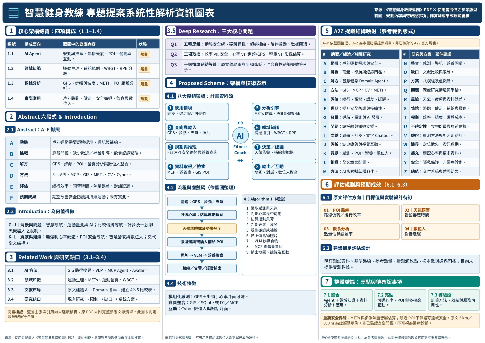
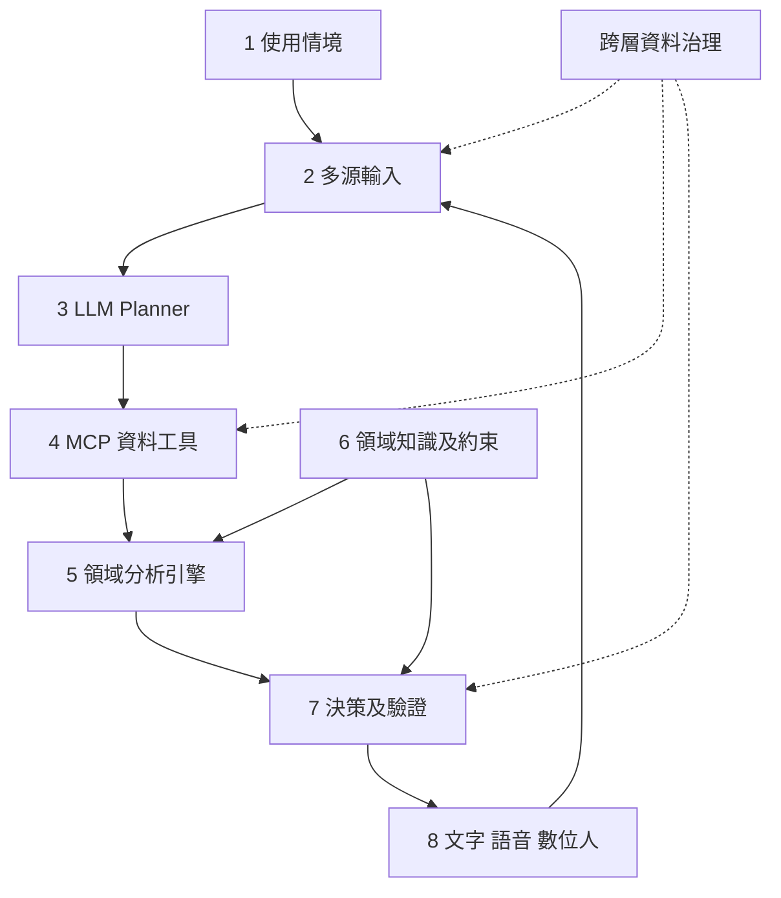
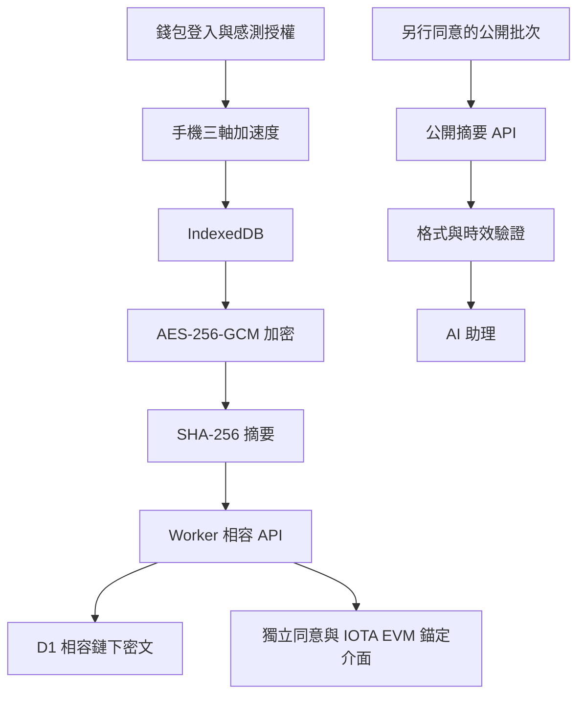

# AI Fitness Coach — A2Z Research Proposal

**研究題目：** AI Fitness Coach：整合情境感知、工具協作決策與可信資料管理之智慧運動教練

**English title:** AI Fitness Coach: Context-Aware Fitness Coaching through Tool-Orchestrated Decision-Making and Verifiable Data Management

**版本：** 2026-11-25｜研究提案與原型進度  
**Repository：** AIOT-DIC3（非系統名稱）

本文件依使用者提供的《2020 A-Z SOP》第 1 頁重構：Abstract (A–F)、Introduction (G–L)、Related Work (M–O)、Proposed Scheme (P，細分 PA–PM)、Simulation (Q–V)、Conclusion (W–Z)。原始資訊圖為早期架構參考；其字母映射與本次 SOP 不一致時，以 SOP 為準。本文為提案，不將預期成果描述為已驗證的研究結果。



*圖 1：原始專題架構；新版保留八模組並增加跨層資料治理。*

## Abstract

### A. Attention Getter — Motivation

2025 年臺灣運動現況調查顯示，13 歲以上民眾運動參與比例為 83.3%，規律運動比例僅為 35.6%，相差 47.7 個百分點。[1] 此落差凸顯持續運動支援的研究價值，但不能直接歸因於缺乏智慧教練。智慧型手機與生成式 AI 的發展，使戶外運動服務有機會由活動紀錄轉向即時情境理解及行動決策。

### B. But — Challenges

現有運動紀錄、地圖、氣象及營養服務已具有各自的分析功能，但如何在缺少心率穿戴資料、外部資訊不完整及使用者需求改變時，協調這些工具形成適切建議，仍值得研究。2025 年食物影像研究中，ChatGPT 與 Claude 的熱量估算平均絕對百分比誤差（MAPE）均達 35.8%。[3] 此外，手機感測資料的隱私、完整性及授權管理亦是實際部署的挑戰。

### C. Cure — Proposed Solution

本研究提出 **AI Fitness Coach**，以 Domain AI Agent 為核心，整合手機感測、氣象、GIS、運動與營養領域知識、文字／語音／3D 數位人，以及可驗證資料管理。設計重點在於以工具協作、情境約束及使用者確認，形成感知—分析—決策—回饋閉環，而非由 LLM 直接產生缺乏依據的數值或生理判斷。

### D. Development — Method

規劃採 FastAPI、LLM 與 MCP 協調領域工具，利用 GPS、步頻、三軸加速度與氣象資訊建立情境，以路網可達性、補給需求與繞行成本推薦 POI；以 VLM、人工確認與營養資料庫估算攝取量。資料原型以錢包簽章、IndexedDB、AES-256-GCM、SHA-256 及 IOTA EVM 錨定介面管理感測資料；AI 助理僅透過受授權的公開摘要介面取得公開彙總資訊。

### E. Experiments — Evaluation

研究將比較最近點、固定規則及 Agent 決策，並以營養估算、環境提醒、介面比較、資料缺失降級與資料完整性測試補充評估。控制相同輸入、資料版本及測試條件，量測需求符合率、繞行成本、告警延遲、MAE、MAPE、SUS、竄改偵測及系統成本。

### F. Findings — Preliminary and Expected Findings

截至 2026-11-25，開發紀錄載明 56 項本機及模擬測試均通過，涵蓋區塊鏈功能、AI 助理、數位人及音訊分段。[4] 目前尚無完整比較實驗結果。預期貢獻為低穿戴門檻的情境感知決策架構，以及能分別驗證 Agent、人工確認、互動方式與資料完整性機制的評估方法。實際運動安全與長期持續性仍須實證。

**Keywords:** AI Fitness Coach, AIoT, Domain AI Agent, Context Awareness, MCP, GIS, Human–AI Interaction, Data Integrity.

## I. Introduction

### G. General — 現況

智慧運動服務已由計步、距離及配速紀錄，逐步延伸至路線導航及個人化訓練。Strava 提供手機活動記錄及可選心率感測；其 2025 年宣布收購 Runna 的計畫亦反映產業對個人化教練的投入。[2][5] 這些現象支持研究情境的實用性，而非證明本方法有效。

本研究聚焦一般成人的戶外健走、慢跑與活動前後補給。使用者可利用既有手機，不必額外購置心率裝置；若具備其他感測器則可選擇提供。系統不以手機加速度替代臨床生理量測。

### H. However — 詳述挑戰

| 挑戰 | 具體問題 | 研究要求 |
|---|---|---|
| H1 感測門檻 | 心率缺失、定位漂移、背景執行限制 | 明確區分估算與生理量測 |
| H2 決策整合 | 最近補給點未必可達或符合需求 | 先檢查條件，再進行候選排序 |
| H3 生成式誤差 | 份量、油脂及混合料理難由影像確定 | 領域資料檢索及關鍵人工確認 |
| H4 人機互動 | 走跑中不適合長時間操作螢幕 | 比較文字、語音、數位人之效益 |
| H5 資料治理 | 私密感測、資料過期或內容遭修改 | 最小授權、加密、完整性及失效處理 |

環境風險不能以一般氣溫直接等同 WBGT，主觀疲勞不能由步頻下降直接判定。研究的重點是資訊受限時的適當決策支援，而非保證安全或進行醫療診斷。

### I. In literature — 由簡至繁的既有方法

以下為研究方法分類，不是對所有產品的功能斷言。早期活動記錄及最近點查詢提供可重現的簡單基準；規則式系統可明確表達補給、資料有效性與警示條件；多模態模型能理解自然語言與食物影像，但仍可能產生估算錯誤；工具導向 Agent 則可協調 GIS、營養與環境分析，但會引入延遲、非確定性與額外成本。資料治理為上述各方法均可採用的橫向能力，不應與 Agent 效益混為一談。

### J. Judgement — 方法評析與 SWOT

| SWOT | 對 AI Fitness Coach 的研究意義 |
|---|---|
| Strengths | 手機入口、工具輸出可追溯、規劃中的跨情境協調 |
| Weaknesses | 感測品質有限、工具依賴、模型與介面延遲 |
| Opportunities | 個人化運動服務、低操作負擔、可驗證資料管理 |
| Threats | 錯誤警示、定位與個資外洩、模型幻覺、第三方服務中斷 |

不能僅以功能數量證明創新；應以同等資料及限制比較各方法，檢驗增量效益。

### K. Keypoint — 設計精神、Novelty 與貢獻

主要研究目標是 **Context-Constrained Tool-Orchestrated Coaching**：在資料不完整、環境改變與使用者偏好等限制下，協調工具並提供可解釋行動建議。預期貢獻包括：(1) 低穿戴門檻的情境建模與 POI 決策；(2) 人機協作的營養估算；(3) 控制資訊內容的多模態介面比較；(4) 具授權及完整性驗證的感測資料管理；(5) 可重現的多層評估框架。跨模組組合是本研究的設計主張，尚未證明其為全球首創。

### L. List the organization — 論文組織

第二章比較既有研究與新方法；第三章由 PA–PM 完整定義目標、架構、形式化方法、流程、範例與理論性質；第四章以 Q–V 說明指標、基準、實驗設定、參數、結果及有效性；第五章以 W–Z 回顧貢獻、適用情境、成果與未來研究。

## II. Related Work

### M. Methods — 文獻方法分類

| 方法類別 | 核心原理 | 評估焦點 |
|---|---|---|
| 活動記錄與地理查詢 | GPS、步頻、最近點 | 距離、定位與操作效率 |
| 規則式領域決策 | 門檻、條件、固定排序 | 可重現性、誤報與漏報 |
| 多模態生成式方法 | LLM、VLM、自然語言 | 估算誤差、幻覺及互動 |
| 工具協作智慧代理 | MCP、工具檢索、領域計算 | 需求符合率、失效處理與成本 |

既有 Repo 引用包括 Strava 功能文件及食物影像估算研究。[2][3] 目前文獻尚不足以支持全面的系統性回顧；後續應補足各類同儕審查研究、檢索條件及納入排除標準。

### N. New proposed — 新趨勢與本研究差異

本研究不以更換 LLM 為主要創新，而以「LLM 理解與協調、工具檢索與計算、規則限制與驗證」作為責任分工。系統先建模情境，再對候選行動進行硬性限制檢查及成本排序；營養估算以人工確認與資料庫建立依據；多模態介面不改變建議內容；資料治理模組與即時決策解耦，避免鏈上交易成為一般教練服務的必要等待條件。

### O. Organize — 4×5 方法比較表

依 SOP 所要求，以四類方法、五項比較維度整理；此為概念比較，非產品實測結果。

| 方法 | 情境資料 | 決策彈性 | 定量依據 | 可解釋／失效 | 代價與限制 |
|---|---|---|---|---|---|
| 活動記錄／最近點 | 位置與活動 | 低 | 距離計算 | 容易重現 | 忽略部分需求 |
| 固定規則 | 預定欄位 | 受規則限制 | 明確公式 | 規則可查 | 情境擴充成本 |
| 通用 LLM／VLM | 語言、影像 | 高 | 可能未經驗證 | 輸出變異 | 幻覺與估算誤差 |
| 提案 Agent | 多源且受約束 | 工具協作 | 領域工具與確認 | 規劃來源與降級 | 延遲、整合與維護成本 |

## III. Proposed Scheme — P (PA–PM)

### PA. Aim / Statement — 研究目標

在手機可取得的有限資料下，建立能依使用者意圖、環境及路線限制推薦可行行動的智慧教練，並驗證其相較簡單基準的效益。主要任務為補給、休息及活動退出地點推薦；營養、互動與資料治理為可獨立驗證的支援研究。

### PB. Based on / Background / Benefit — 理論與設計依據

以情境感知、約束式決策、領域工具協作、METs 能量估算、人機協作及密碼學資料驗證為設計基礎。WBGT 與 RPE 分別為候選環境熱負荷及自述用力程度資訊，不由缺少必要輸入的模型任意生成。預期效益為資訊整合及減少不必要操作，須由第四章驗證。

### PC. Cure / Cause — 解法與作用機制

| 問題 | 解法 | 為何可能有效 |
|---|---|---|
| 無心率 | 有限感測＋自述＋降級 | 減少無依據生理推論 |
| 補給決策 | GIS 硬限制＋成本排序 | 排除不符合需求的候選 |
| 營養誤差 | VLM＋人工確認＋DB | 修正關鍵輸入及數值來源 |
| 互動負擔 | 語音與可選 Avatar | 提供不必持續看螢幕的選項 |
| 資料管理 | 加密、授權、摘要 | 提供機密性及完整性驗證機制 |

### PD. Design — 架構設計與典範轉移

由 Activity Tracking 轉為 Context-aware Action Support。規劃 FastAPI 作為教練後端，MCP 為工具介面，LLM 為協調者，領域引擎為計算者，規則驗證器為輸出限制。感測資料管理原型採 Worker／D1 相容架構，與教練後端之間以受控 HTTP JSON 摘要介面整合；不假定二者已完成端到端串接。

### PE. Paper elements — 八模組與橫向治理

| ID | 模組 | 輸入 → 輸出 |
|---|---|---|
| 1 | 使用情境 | 活動與需求 → 任務 |
| 2 | 查詢與輸入 | GPS、步頻、照片、語音 → 結構化輸入 |
| 3 | 規劃與推理 | 情境與意圖 → 工具計畫 |
| 4 | 資料取得 | MCP、GIS、氣象與營養查詢 → 附來源資料 |
| 5 | 分析引擎 | 領域資料 → 路網、METs、營養計算 |
| 6 | 領域知識 | 補給規則、RPE、候選 WBGT → 約束 |
| 7 | 決策與建議 | 候選與約束 → 排序、理由或降級 |
| 8 | 輸出互動 | 決策 → 文字、語音、3D 數位人 |
| Cross-cutting | 資料治理 | 授權、時效、加密、摘要驗證與稽核 |

### PF. Formulation / Foundation — 數學模型

令時間 t 的狀態為 $s_t=(p_t,c_t,w_t,r_t,u_t,q_t)$，分別表示位置、步頻、氣象、自述狀態、使用者需求及資料品質。缺失欄位明確標示 unknown，不能當成零或正常值。

候選 POI 集合 $P$ 經硬限制後形成 $F(s)=\{i\in P:h_j(i,s)=1,\ \forall j\}$。限制包含需求類型、路網可達性及必要資料有效性；未知的必要條件不得視為通過。若 $F$ 為空則不產生推薦，轉為追問或適當降級。

對可行候選定義正規化成本：

$$J_i=\alpha d_i+\beta t_i+\gamma r_i+\delta b_i,\qquad \alpha+\beta+\gamma+\delta=1$$

其中 $d_i$ 為繞行距離、$t_i$ 為額外時間、$r_i$ 為可取得且已定義的環境代價、$b_i$ 為偏好不符合成本；各項位於 [0,1]，權重非負。選擇 $i^*=\arg\min_{i\in F}J_i$；同分時依固定 ID 排序。若缺少必要風險資訊，不以零代價掩蓋缺失。這是候選研究模型，不是既有實作證據。

運動總能量估算（kcal）：

$$E=MET\times3.5\times m_{kg}\times t_{min}/200$$

營養估算：

$$N_k=\sum_{i=1}^{n}\frac{g_i}{100}v_{ik}$$

$g_i$ 為確認份量（g），$v_{ik}$ 為每 100 g 的第 k 項營養值。結果受份量與資料來源誤差限制；區間須有明確假設，不能直接稱為統計信賴區間。

資料驗證以完整加密 JSON 的 UTF-8 位元組 B 計算 $h=SHA256(B)$。收到資料後比對可信參考摘要，並於解密時驗證 AES-GCM 認證標籤。摘要只能驗證內容一致性，不能證明原始感測真實。

### PG. Graph — 架構圖與資料流



圖 2：規劃中的閉環架構。規則與工具共同限制決策，不由 LLM 自行生成定量依據。



圖 3：資料管理原型。公開批次與加密錄製資料分離；目前實際鏈寫入停用。

### PH. How — 如何達成目標

情境更新時，系統先驗證來源、時間戳、必要欄位與使用者意圖，再依任務取得相應工具資料。硬限制先於排序，必要條件未知時不輸出假確定推薦。營養任務先確認食物與份量再計算；介面只呈現經過驗證的結構化結果。語音與數位人不得自行改寫關鍵數值或安全限制。

### PI. Implementation / Interaction — 實作與虛擬碼

```text
Algorithm: Context-Constrained Fitness Coaching
Input: context, user_request, approved_tools, consent
Output: recommendation or explicit fallback

1. Validate required fields, timestamps and permissions.
2. Determine intent; if ambiguous, request clarification.
3. If user reports urgent warning symptoms:
      return stop-activity and appropriate emergency-assistance guidance.
4. Select approved domain tools for the task.
5. Execute tools with bounded retries and validate outputs.
6. If essential inputs fail, return limited advice or fallback.
7. For POI tasks:
      generate candidates; filter hard constraints;
      if none remain, return no verified candidate;
      rank feasible candidates by normalized cost.
8. For nutrition tasks:
      recognize food; confirm portion; retrieve nutrients;
      compute estimate with assumptions and sources.
9. Render the same validated content via selected interface.
10. Record permitted decision metadata; update context.
```

原型資料管理目前採 DeviceMotionEvent（最高 4 Hz、每次最多 2,880 筆）、IndexedDB、Web Locks、錢包一次性簽章、AES-256-GCM、SHA-256、冪等上傳及獨立公開／錨定同意。完整教練流程、正式 D1、真實鏈交易及語音端到端尚待驗證。

### PJ. Jump to an example — 情境範例

以下純為虛擬示例，非實測、非安全距離門檻。跑者希望補水；最近點 A 距離 150 m，但路網資料顯示不可達；B 及 C 均符合需求且可達。令權重為 (0.4, 0.3, 0.2, 0.1)。

| POI | 可行 | d | t | r | b | J |
|---|---|---:|---:|---:|---:|---:|
| A | 否 | — | — | — | — | 排除 |
| B | 是 | 0.3 | 0.4 | 0.2 | 0.1 | 0.29 |
| C | 是 | 0.2 | 0.2 | 0.6 | 0.4 | 0.30 |

依模型推薦 B，並說明其綜合成本較低；若環境資料過期則重新取得或降級，不延用虛假的風險分數。A 的排除並不代表 B 保證安全。

### PK. Key points contribution — 技術貢獻重述

主要貢獻為情境約束與工具協作的決策方法，以及可追溯的輸出驗證流程。支援貢獻為人工確認營養估算、內容一致的介面比較及與教練決策解耦的資料治理。每項貢獻均對應第四章的一項或多項實驗。

### PL. Later how to do simulation — 實驗銜接

固定 POI 路網及氣象快照，比較最近點、固定規則、約束排序及完整 Agent；再以移除人工確認、移除降級檢查、不同介面及移除錨定等消融比較，分離各模組效益。測試量與指標見 Q，方法見 R，設定見 S，參數見 T，結果及驗證見 U–V。

### PM. Math proof — 有限模型的理論性質

**命題 1（可行性）：** 若 F 非空，且硬限制判定正確，選出的最小成本候選屬於 F。證明：最小化的定義域即 F，因此任何解均滿足 F 的定義。這只保證模型約束，不保證真實世界安全。

**命題 2（支配性）：** 對兩個可行候選 i、j，若 i 的每項成本均不高於 j，且至少一項具有正權重的成本嚴格較低，則 $J_i<J_j$。證明：將各項差值乘非負權重並加總，至少一項嚴格為正，因此 $J_j-J_i>0$。

**命題 3（排序複雜度）：** 若有 n 個候選及 k 個固定檢查，過濾與計算成本為 O(nk)；選最小值為 O(n)，完整排序為 O(n log n)。不包含 GIS 路網查詢、LLM、網路及資料庫等外部成本。此為概念演算法分析，不代表已實測延遲。

SHA-256 的抗碰撞性與 AES-GCM 的安全性依賴標準密碼學假設及正確實作；不聲稱本文證明密碼原語安全。LLM 建議品質、使用者行為與真實環境效益亦不能由上述命題推出。

## IV. Simulation

### Q. Quality and Quantity — 實驗規模與指標

以下為可執行的初始研究規模建議，非既有資料集或已招募人數。正式樣本量須依先導測試、效應大小、倫理審查及資源調整。

| ID | 研究問題 | 初始建議規模 | 主要指標 |
|---|---|---|---|
| E1 | POI 決策 | 120 個固定情境 | 有效推薦率、需求符合率、繞行距離 |
| E2 | 氣象提醒 | 60 個正常／異常情境 | 漏報率、誤報率、告警延遲 |
| E3 | 營養分析 | 60 份有秤重參考值的餐點 | MAE、MAPE、紀錄時間 |
| E4 | 人機互動 | 先導 12 人，三介面交叉設計 | SUS、理解率、任務時間、主觀負荷 |
| E5 | 失效處理 | 60 個故障注入案例 | 降級成功率、無依據輸出率 |
| E6 | 資料治理 | 100 個正常及異常資料包 | 竄改偵測、驗證延遲、儲存與錨定成本 |

有效推薦率 = 符合預先標註有效條件的推薦數／全部指定任務數；另報無推薦率及可行案例中的推薦成功率，避免拒答改善表面準確率。繞行距離以路網計算、非直線距離；延遲報 median 及 p95。

$$MAE=\frac{1}{n}\sum_{i=1}^{n}|\hat y_i-y_i|$$

$$MAPE=\frac{100}{n}\sum_{i=1}^{n}\left|\frac{\hat y_i-y_i}{y_i}\right|$$

MAPE 僅使用非零參考值，零值以 MAE 等絕對誤差另行分析。所有比例保留分子、分母及失敗數。

### R. Related method to compare — 基準與消融方法

| 實驗 | Baseline | Proposed / Ablation |
|---|---|---|
| E1 | 直線最近點、路網最近點、固定規則 | 約束排序；同排序加 Agent |
| E2 | 固定警示 | 情境式提醒；移除時效檢查 |
| E3 | VLM 直接估算 | VLM＋DB；VLM＋確認＋DB |
| E4 | 文字 | 語音、3D Avatar；內容一致 |
| E5 | 未設專門降級的工具調用 | 時效／格式／必要欄位檢查＋降級 |
| E6 | 一般儲存；加密及可信鏈下摘要 | 再加獨立鏈錨定（部署後） |

基準方法應使用相同資料快照；E1 必須獨立比較約束排序與 Agent，避免把演算法改良全部歸功於 LLM。E6 不應為了比較而實際公開個人明文；使用合成資料。

### S. Simulation Setup — 實驗環境

分三階段：S1 離線固定資料與故障注入；S2 手機實機、外部 API 與後端整合；S3 經適當倫理程序的使用者研究。記錄硬體、OS、模型版本、prompt、temperature、MCP 工具版本、GIS 路網版本、氣象時間、資料庫版本與執行時間；目前未確定項目標示 TBD。

E1 場景依一般健走、補水、公廁、休息、提前結束，以及不可達或資料過期等條件分層；標註規則須先訂定。E2 以明確環境警示規則及對應資料作參考，不以模型回答為真值。E3 使用秤重及可追溯營養資料；E4 以相同訊息、任務、平衡順序比較三介面；E5 注入定位遺失、API 中斷、格式錯誤、過期摘要及模糊需求；E6 使用正常、竄改、重送、未授權、過期及錨定失敗資料包。所有重複試驗保留 case ID 與執行設定，避免以調參資料作最終測試。

### T. Tuning — 待調參數與敏感度分析

| 參數 | 候選設定（研究建議） | 分析目的 |
|---|---|---|
| POI 權重 | 等權、距離優先、環境優先；總和 1 | 排序穩健性 |
| LLM temperature | 0、0.3、0.7（模型支援時） | 輸出一致性 |
| 工具 timeout | 2、5、10 秒 | 效率與失效權衡 |
| 重試次數 | 0、1、2 | 成功率及延遲 |
| 感測頻率 | 1、2、4 Hz（原型能力內） | 資料量與資源成本 |
| 人工確認 | 無、品項、品項＋份量 | 誤差與操作時間 |
| 介面 | 文字、語音、Avatar | 負荷及理解差異 |

資料時效門檻依各資料來源更新頻率及領域需求訂定，不設定未驗證的醫療警示閾值。使用開發集挑選設定，保留獨立測試集；固定其餘條件做單因子敏感度分析，再選擇必要交互作用。記錄模型隨機性及重複次數。

### U. Useful results — 結果呈現與目前成果

**目前有紀錄的原型測試（2026-11-25）**

| 模組 | 通過 | 失敗 |
|---|---:|---:|
| Blockchain 功能 | 37 | 0 |
| AI 助理整合 | 11 | 0 |
| 數位人 | 4 | 0 |
| 音訊分段 | 4 | 0 |
| 合計 | 56 | 0 |

來源為開發紀錄，[4] 未重新執行。此結果不等同 E1–E6 或正式部署成果。

| 計畫中的結果 | Baseline | Proposed | 差異及區間 |
|---|---|---|---|
| E1 需求符合率、繞行距離 | 待測 | 待測 | 待分析 |
| E2 告警延遲、漏報與誤報 | 待測 | 待測 | 待分析 |
| E3 MAE、MAPE、紀錄時間 | 待測 | 待測 | 待分析 |
| E4 SUS、理解與任務時間 | 待測 | 待測 | 待分析 |
| E5 降級與無依據輸出 | 待測 | 待測 | 待分析 |
| E6 驗證、成本與延遲 | 待測 | 待測 | 待分析 |

完成後以配對差異、分布圖、誤差區間及失敗案例呈現，而非僅列平均數。

### V. Verify — 如何驗證有效性

| 假設 | 驗證方法 | 支持條件（待預註冊） |
|---|---|---|
| H1 Agent 改善推薦 | 同情境配對比較 E1 | 需求符合率提升，成本可接受 |
| H2 人機協作改善營養估算 | 同餐點比較 E3 | 誤差降低，確認成本可接受 |
| H3 介面影響互動 | 交叉設計 E4 | 理解、負荷或時間存在可量化差異 |
| H4 降級減少無依據輸出 | 故障注入 E5 | 無依據輸出減少且有效覆蓋率可接受 |
| H5 錨定提供增量驗證價值 | E6 比較可信鏈下摘要與鏈錨定 | 明確的威脅模型下有額外可驗證性，代價可接受 |

二元配對結果可用 McNemar 檢定；連續配對結果依分布與設計選用配對 t 檢定或適當非參數方法；三介面重複測量依資料特性選用重複量測方法。報告效應大小及適當信賴區間，多重比較需控制錯誤率。先導研究以可行性與效應估計為主，不以小樣本宣稱普遍有效。正式成功門檻於實驗前制定；若結果不支持假設，應如實呈現。

## V. Conclusion

### W. What proposed — 回顧研究動機與方法

本研究針對運動參與與規律運動的落差所提示的支援需求，以及手機感測限制、分散工具、營養估算誤差與資料隱私問題，提出 AI Fitness Coach。透過情境建模、工具協作及約束驗證，探索由被動活動紀錄轉向主動決策支援的可行性。

### X. eXcel — 適用情境與方法優勢

本方法預期特別適用於不強制配戴心率裝置的一般戶外健走及慢跑，且使用者存在補給或活動結束需求的情境。硬限制與成本排序具有明確可檢查的性質；人工確認可針對份量不確定性；多模態呈現可降低操作門檻的假設仍待驗證。系統不診斷疾病、不保證路線安全，也不以加速度直接測定疲勞。

### Y. Yields — 實際產出與待驗證結果

目前已有研究摘要、A–F、A2Z、資訊圖與資料管理原型紀錄；56 項本機及模擬測試均通過。尚無完整 POI、氣象、營養及使用者實驗結果，亦未證明正式鏈上錨定、手機實機或端到端整合。預期交付可操作的教練原型、匿名／合成或經同意的實驗資料、可重現測試腳本、比較結果及研究報告。

### Z. Zen — 結論、限制與 Future Work

研究價值在於將 AI Agent、領域工具、人機協作及資料治理組織成可分別驗證的研究架構，而非僅堆疊技術。後續優先完成情境決策與實機感測、營養及介面整合，再進行正式部署及比較實驗；可選心率、長期運動持續性、在地營養資料及個人化模型列為延伸研究。使用者須分別同意感測、公開及鏈錨定；不得上鏈原始個資；撤回公開同意不等同刪除既有鏈上資訊。胸痛、昏厥等警訊應停止運動並尋求適當緊急協助。真正的運動安全與長期效益須待實證，不以原型功能測試代替。

## References and source documents

[1] [2025 年臺灣運動現況調查報導](https://news.pts.org.tw/article/787192)  
[2] [Strava 官方活動記錄說明](https://support.strava.com/en-us/articles/15402137-how-do-i-record-an-activity-on-strava)  
[3] [2025 食物影像營養估算研究](https://pubmed.ncbi.nlm.nih.gov/41081011/)  
[4] [Blockchain 感測資料系統開發紀錄](blockchain-development.md)  
[5] [Strava to acquire Runna](https://press.strava.com/articles/strava-to-acquire-runna-a-leading-running-training-app)

研究來源：[Abstract](../Abstract.md) · [A–F](A_to_F.md) · [README](../README.md) · [原始資訊圖](AIOT-DIC3.jpg) · [藍圖 PDF](智慧健身教練藍圖.pdf)

格式依據：使用者提供《A2Z outline example.pdf》，第 1 頁「2020 A-Z SOP」。原始 Repo 藍圖 PDF 未直接解析，透過已讀取的資訊圖及文字文件間接參考。外部文獻沿用 Repo 引用，未重新核對全文。新增成本模型、數學命題、樣本規模、參數及統計方案皆為提案設計，未經實測。
