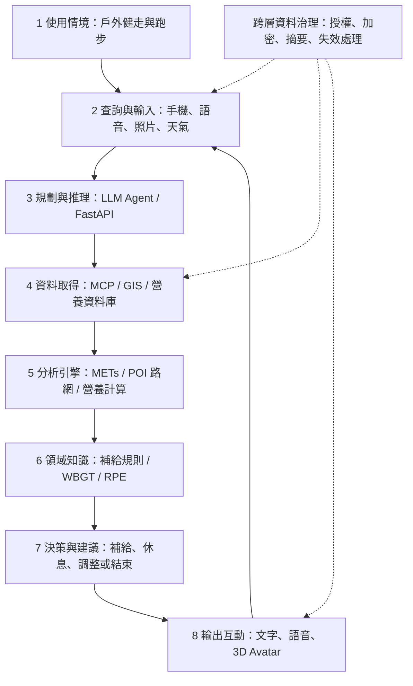
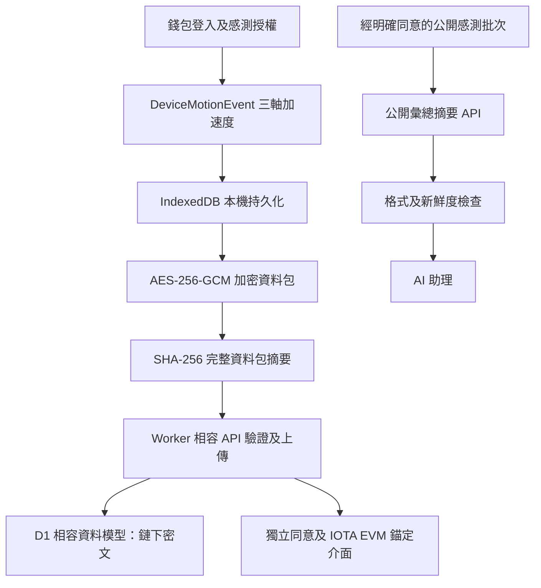

# AI Fitness Coach — A2Z 研究提案與系統設計

> Context-Aware AI Fitness Coach: Multi-Source Sensing, Agent-Based Decision-Making, Multimodal Interaction, and Verifiable Data Management

- 研究主題／系統名稱：AI Fitness Coach（智慧運動教練）
- Repository：AIOT-DIC3
- 文件版本：2026-11-25，研究提案與原型進度整合版
- 適用情境：一般成人戶外健走、慢跑與日常運動補給；非醫療診斷系統。

本文件沿用原資訊圖的 A–P 研究架構及 Q–Z 延伸項目，將現行摘要與新增的區塊鏈感測資料原型納入同一研究敘事。Q–Z 為專題延伸設計，並非經核實的官方 A2Z 規範。

*圖 1：原始研究架構與 A2Z 對照。圖中規劃項目並非已完成的功能；本文依最新摘要與開發紀錄補充資料安全及實驗界線。*

## Part I — Abstract（A–F）

### A. Attention Getter — 研究動機

2025 年臺灣運動現況調查顯示，13 歲以上民眾運動參與比例達 83.3%，規律運動人口比例僅為 35.6%，相差 47.7 個百分點。[1] 如何支持使用者持續運動，是值得探討的研究課題。此差距不能直接歸因於缺乏 AI 教練。

當使用者在戶外跑步或健走時，天候變化、補水需求、主觀疲勞及提前結束活動等問題，需要的是下一步行動建議，而非只有距離與配速紀錄。本研究以手機為主要入口，探索低穿戴門檻、具情境感知的智慧運動支援。

### B. But — 挑戰與研究缺口

現有運動平台已有活動記錄、導航及部分安全功能，並非一律要求心率裝置。[2] 本研究聚焦四項待驗證問題：

1. **感測限制**：缺乏心率資料時，如何在不誇大生理判斷能力的前提下，利用 GPS、步頻、加速度與自述狀態支援決策？
2. **資訊割裂**：天氣、地圖與補給需求如何共同納入決策，而非僅顯示資訊或推薦最近地點？
3. **估算不確定性**：2025 年食物影像研究中，ChatGPT 與 Claude 的熱量估算 MAPE 均為 35.8%。[3] 如何透過人工確認及資料庫改善估算品質？
4. **資料管理**：手機感測資料涉及個人隱私，如何實施加密、授權、完整性驗證及資料失效處理？

### C. Cure — 提出方法

本研究提出 **AI Fitness Coach**，以 Domain AI Agent 為核心，結合 AIoT、MCP、GIS、運動與營養領域知識、多模態互動及可信資料管理，建立感知—分析—決策—回饋閉環。

核心原則為「AI 負責理解與協調，領域工具負責檢索與計算，明確規則負責限制與驗證」。系統依情境推薦補給、休息或結束活動地點；透過人機協作營養紀錄降低輸入負擔；並以文字、語音與 3D 數位人呈現建議。區塊鏈為資料完整性支援模組，不是教練決策的必要前提。

### D. Development — 方法與技術

規劃以 FastAPI 與 MCP 串接感測、氣象、GIS、METs、VLM 與營養資料庫。運動當量用於能量消耗估算，WBGT 與 RPE 作為環境熱負荷及主觀用力程度的候選領域指標，不用手機加速度直接推斷生理疲勞。

資料管理原型使用 DeviceMotionEvent、IndexedDB、AES-256-GCM、SHA-256、錢包簽章及 Cloudflare Worker／D1 相容介面；IOTA EVM 用於規劃中的鏈上摘要錨定。透過經授權的公開摘要 API 支援 AI 助理，避免將原始個人感測資料直接公開。

### E. Experiments — 評估方法

比較最近 POI、固定規則與 Agent 決策；固定警示與情境式提醒；VLM 直接估算與人工確認加資料庫；文字、語音及數位人介面。另測試資料缺失降級、授權隔離、密文竄改偵測與錨定成本。

2026-11-25 開發紀錄載明 56 項本機與模擬測試均通過（Blockchain 37、AI 助理 11、數位人 4、音訊分段 4）。此為原型功能測試結果，非正式戶外研究或完整系統驗證。[4]

### F. Findings — 預期成果

預期交付一套低穿戴門檻、可解釋且具失效處理能力的 AI Fitness Coach 原型，以及可重現的比較實驗框架。研究將檢驗工具協作能否改善推薦適切性、人機協作能否降低營養估算誤差，以及多模態介面與資料驗證機制的效益及代價。運動安全與長期持續性改善仍須實證，不預先承諾改善幅度。

## Part II — Introduction（G–L）

### G. General Background — 研究背景

智慧型手機已具定位、動作感測、網路與影像擷取能力；GIS 提供路網及地點資訊；生成式 AI 可理解自然語言。這些技術使運動支援從單純記錄擴展至多源資訊協作成為可能。研究選擇戶外健走及慢跑，因其可在不購置專用穿戴裝置的情境下使用，但仍需考慮手機背景執行、電力及定位品質。

### H. Highlighted Problem — 問題定義

令情境狀態 s 包含位置、活動時間、步頻、環境資料、使用者意圖與主觀狀態。研究目標是在資料品質與安全限制下選擇適當行動 a，包括繼續活動、補給、休息、調整路線或結束活動，並說明建議依據。若必要資訊缺失，應追問、提供有限建議或拒絕給出無依據的判斷。

### I. Investigation — 相關研究與技術

| 研究方向 | 技術與依據 | 本研究切入點 |
|---|---|---|
| 運動追蹤 | GPS、步頻、可選心率 | 無心率情境下的適當建議 |
| 智慧導航 | GIS、POI、路網分析 | 多條件約束與可達性 |
| 運動生理 | METs、RPE、WBGT | 估算與警示的適用界線 |
| AI Agent | LLM、MCP、工具調用 | 可追溯的跨工具決策 |
| 營養分析 | VLM、秤重、營養資料庫 | 人工確認及不確定性 |
| 人機互動 | 文字、語音、3D Avatar | 相同內容下的介面比較 |
| 資料完整性 | AEAD、雜湊、鏈上錨定 | 授權、驗證與成本 |

### J. Judgment — 現有方法評析

Strava 等平台已具備手機活動記錄及部分路線功能，心率可選配；個人化訓練也是既有產業方向。[2][5] 因此不能以「競品沒有導航／AI」作為創新主張。應以相同情境、相同資料與限制，比較 Agent 是否比簡單規則更適合，並評估是否引入額外延遲、錯誤或成本。

### K. Key Contributions — 研究貢獻

- Intelligence：多源情境建模與受約束的 POI 決策。
- Human–AI Collaboration：影像辨識、人工確認及領域資料庫協作。
- Interaction：控制建議內容後，比較文字、語音及數位人。
- Trustworthiness：以加密、授權、摘要驗證及規劃中的鏈錨定管理資料。
- Evaluation：建立跨模組、具基準方法與失效測試的評估框架。

上述為預期貢獻，尚待完整研究驗證。

### L. Layout — 文件與論文組織

A–F 為摘要；G–L 為緒論；M–O 為相關研究、技術整合與研究缺口；P 為提出架構；Q–U 為研究問題、風險、情境、權衡及不確定性；V–Y 為驗證、界線、延伸與安全；Z 為總結與交付成果。

## Part III — Related Work & Proposed Scheme（M–P）

### M. Methods — AI 與領域方法

AI 端負責意圖辨識、任務規劃及工具協調；領域端負責可重現的計算與資料檢索。候選能量估算式（總消耗）為：

$$E_{kcal}=MET\\times 3.5\\times m_{kg}\\times t_{min}/200$$

MET 值依活動類型與強度選擇，結果僅為估計。營養估算以確認份量乘每 100 g 營養值再除以 100，混合餐點則加總各品項。WBGT 需適當來源或經驗證的估算方法；一般氣溫不可直接當作 WBGT。RPE 為使用者主觀回報，不是感測器直接量測值。

### N. Nexus — 多源整合

| 資料來源 | 使用方式 | 品質／限制 |
|---|---|---|
| GPS、步頻、時間 | 活動情境及路線 | 定位漂移、資料缺失 |
| 三軸加速度 | 動作樣本與資料管理研究 | 取樣限制、非心率 |
| 氣象服務 | 環境提醒 | 更新時間、地理適用性 |
| GIS POI 與路網 | 補給與活動退出候選 | 營業資訊、可達性 |
| 食物影像與營養資料 | 餐點估算 | 份量、油脂及資料匹配 |
| 使用者回報 | 意圖、RPE、需求確認 | 自報偏差 |
| 授權公開摘要 | AI 助理的原型資料介面 | 非個人即時運動狀態 |

統一保留來源、時間戳、單位及資料有效狀態；不同來源不得因整合而被視為具有相同可信程度。

### O. Opportunity — 研究缺口與假設

H1：情境式 Agent 推薦較最近點查詢更符合補給與退出需求。H2：影像辨識加人工確認及資料庫，較直接 VLM 估算具有較低營養誤差。H3：在相同建議內容下，多模態介面可能影響理解與操作負擔。H4：資料驗證機制能偵測指定的竄改情境，但可能增加時間、儲存及操作成本。H5：缺少必要資料時，明確降級機制可降低無依據輸出的比例。假設皆須實測。

### P. Proposed Scheme — 八模組架構

依原資訊圖保留八模組，並新增橫跨各層的資料治理支援。

概念流程：讀取情境 → 檢查資料完整性及時效 → 確認意圖 → 判斷是否需提醒或追問 → 調用領域工具 → 過濾不可行候選 → 排序並解釋 → 輸出及更新情境。若使用者上傳食物影像，則進入 VLM 辨識、人工確認、資料檢索及估算分支。

**候選 POI 決策方法（提案）：** 先以需求符合、路網可達性及必要資料有效性篩選，再對繞行距離、耗時及偏好等正規化成本排序。權重須透過實驗設定與敏感度分析，不以距離單一指標決定適切性。

**資料管理原型流程：**

公開批次與加密錄製資料分離；v1 公開摘要不包含加密錄製資料。錨定介面已建立原型但實際鏈寫入停用。雜湊只能比對指定資料包的完整性，不能證明感測內容真實。

## Part IV — Deep Research（Q–U）

### Q. Questions — 核心研究問題

RQ1：在定位、天氣及補給需求變化下，Agent 的決策品質是否優於最近點及規則式方法？RQ2：在降低輸入負擔的同時，人機協作能否改善營養估算？RQ3：文字、語音與數位人是否帶來不同的理解率、負擔及使用意願？RQ4：資料加密及摘要錨定的驗證效益與成本為何？RQ5：當感測或外部服務失效時，如何維持適當的降級與不確定性揭露？

### R. Risks — 風險分析

| 風險 | 影響 | 建議處理 |
|---|---|---|
| 天候資料過期 | 不適當提醒 | 時效檢查、告知不確定性 |
| GPS 漂移或路網錯誤 | 不可行路線 | 不將候選描述為保證安全 |
| 主觀疲勞資訊不足 | 過度推論生理風險 | 追問、限制輸出 |
| 食物份量不明 | 熱量估算偏差 | 確認份量並揭露假設 |
| 工具中斷或幻覺 | 虛構資料 | 格式驗證、降級與拒絕捏造 |
| 敏感資料外洩 | 隱私侵害 | 最小化、隔離與加密 |
| 鏈上資料不可撤回 | 長期隱私風險 | 不上鏈原始個資、獨立同意 |

### S. Scenarios — 應用情境

| ID | 情境 | 預期系統行為 |
|---|---|---|
| S01 | 一般戶外健走 | 提供活動資訊與估算條件 |
| S02 | 跑步中天候惡化 | 提醒環境變化、提供適當選項 |
| S03 | 使用者想補水 | 依需求及可達性推薦候選 |
| S04 | 使用者想找公廁 | 依地點類型及路網篩選 |
| S05 | 主觀疲勞、想提前返回 | 建議休息或結束活動，不診斷 |
| S06 | 定位遺失 | 暫停依賴即時位置的推薦 |
| S07 | 氣象 API 不可用 | 說明無法取得最新資訊 |
| S08 | 上傳混合餐點照片 | 辨識候選並確認品項、份量 |
| S09 | 營養資料庫無匹配 | 告知無法可靠估算或請求補充 |
| S10 | 摘要過期或資料包遭修改 | 拒絕使用過期摘要／完整性驗證失敗 |

### T. Trade-offs — 技術權衡

| 取捨 | 研究策略 |
|---|---|
| 效率 vs. 安全限制 | 先檢查必要條件，再考量延遲 |
| 心率精度 vs. 硬體門檻 | 心率可選，無心率時限制推論 |
| 人工確認 vs. 紀錄便利性 | 測試誤差改善與確認成本 |
| 數位人表現 vs. 響應延遲 | 與文字、語音對照 |
| 加密及錨定 vs. 系統成本 | 分離基本加密與鏈錨定增益 |
| Agent 彈性 vs. 規則可重現性 | 固定資料與基準方法，保存測試設定 |

### U. Uncertainty — 不確定性處理

依資料來源、時效、缺失、份量及估算假設辨識不確定性。必要時要求確認，若資訊不足則輸出區間或條件式結果；區間須有明確生成依據，未經校準不得稱為統計信賴區間。模型自述信心不可直接當作正確機率。公開摘要無效、過期或不可用時，不生成事件數與鏈上確認結果。

## Part V — Evaluation & Extensions（V–Z）

### V. Validation — 實驗與驗證

| 實驗 | 基準／比較組 | 指標 |
|---|---|---|
| E1 POI 決策 | 最近點、固定規則、Agent | 需求符合率、有效推薦率、繞行距離 |
| E2 環境提醒 | 固定警示、情境式建議 | 告警延遲、漏報、誤報、適切性 |
| E3 營養估算 | VLM 直接估算、確認加資料庫 | MAE、MAPE、紀錄時間、修正次數 |
| E4 介面 | 文字、語音、3D Avatar；內容一致 | SUS、理解率、任務時間、主觀負擔 |
| E5 降級 | 正常、缺失、過期、服務中斷 | 降級成功率、無依據輸出率、一致性 |
| E6 資料驗證 | 一般儲存、加密加摘要、再加錨定 | 竄改偵測、驗證延遲、儲存／交易成本 |
| E7 持續使用（延伸） | 多週試用或對照研究 | 留存、完成運動次數、提醒關閉率 |

研究應先定義地點適切性標註規則與天氣告警基準；營養參考值使用實際秤重及可追溯資料庫。MAPE 僅用於非零參考值，零值另以 MAE 評估。介面研究宜採平衡順序、同等資訊量與一致任務，降低學習及順序效應。樣本數、通過門檻及統計方法應於實驗前依研究資源與效應大小訂定，不預填成績。

**目前已記錄的本機測試（2026-11-25）：**

| 測試類別 | 通過 | 失敗 |
|---|---:|---:|
| Blockchain | 37 | 0 |
| AI 助理整合 | 11 | 0 |
| 數位人 | 4 | 0 |
| 音訊分段 | 4 | 0 |
| 合計 | 56 | 0 |

資料來源為開發紀錄，本文未重新執行測試。上述並非 E1–E7 的研究成效，也不是正式鏈上交易、手機實機、正式 D1 部署或語音端到端驗證。

### W. Weaknesses & Boundaries — 研究界線

本研究聚焦一般成人戶外健走及跑步，不提供醫療診斷。無心率不表示可用加速度準確取代心率或疲勞量測。目前感測原型最高 4 Hz、單次最多 2,880 筆，在最高頻率下約 12 分鐘，不能直接視為長時間連續運動監測。手機背景執行限制、定位品質、第三方 API 可用性及本機明文／金鑰保護仍有風險。雜湊不保證感測資料真實性，鏈上摘要也不等同匿名化。原資訊圖提及的 5 km／500 m 為虛擬示例，非安全門檻。

### X. eXtension — 後續擴充

建議依序完成手機實機與資料品質測試、GIS／氣象工具與 Agent 整合、人機協作營養流程、介面對照、正式雲端與 IOTA EVM 錨定驗證；再評估可選心率裝置、長期活動資料、在地飲食資料與個人化模型。Cybor 數位人為藍圖候選方案，實際整合能力須確認。正式鏈錨定不應阻礙基本運動建議。

### Y. Yield & Safety — 安全、倫理與資料治理

- 明確告知建議非醫療診斷；當使用者回報胸痛、昏厥等警訊時，不鼓勵繼續運動，應建議停止活動並尋求適當緊急協助。
- 不以手機感測直接宣稱生理風險或保障人身安全；不將最近 POI 描述為安全地點的保證。
- 分別取得感測、公開及鏈錨定同意；私密資料採最小化、存取隔離及加密。
- 公開摘要不含錢包、裝置或個人批次識別碼；撤回公開同意後不再提供相關公開批次，但不能保證刪除既有鏈上資料或已被第三方保存的內容。
- 使用者研究應依所在機構倫理規範評估審查需求，並制定告知同意、資料保留與退出流程。

### Z. Zero-to-Outcome — 結論與交付成果

AI Fitness Coach 的研究核心，是將手機感測、環境資訊、領域工具與多模態回饋組織成可解釋的行動決策支援流程，並以資料治理及可驗證性提高系統透明度，而非單純堆疊技術。

| 交付物 | 目前狀態 |
|---|---|
| 研究摘要、A–F 與 A2Z 文件 | 文件已建立 |
| 八模組整體架構 | 研究規劃 |
| 感測、加密、錢包與摘要 API | 文件記載本機原型 |
| AI 助理、數位人、音訊模組 | 文件記載局部測試 |
| GIS／氣象／營養完整決策鏈 | 待端到端整合與驗證 |
| 正式雲端部署、真實鏈上錨定 | 待驗證 |
| 基準比較、使用者研究及安全效益 | 待實證 |

預期成果為系統原型、可重現的評估資料與研究報告。只有在完成 E1–E7 中相應實驗後，才能對推薦品質、估算準確度、互動效益或長期使用提出實證結論。

## References & Source Documents

[1] [2025 年臺灣運動現況調查報導](https://news.pts.org.tw/article/787192)  
[2] [Strava 官方活動記錄說明](https://support.strava.com/en-us/articles/15402137-how-do-i-record-an-activity-on-strava)  
[3] [Food image-based nutritional estimation study, 2025](https://pubmed.ncbi.nlm.nih.gov/41081011/)  
[4] [Blockchain 感測資料系統開發紀錄](blockchain-development.md)  
[5] [Strava to acquire Runna](https://press.strava.com/articles/strava-to-acquire-runna-a-leading-running-training-app)

Repo 文件：[中英文摘要](../Abstract.md) · [A–F](A_to_F.md) · [研究背景與文獻整理](../README.md) · [原始資訊圖](AIOT-DIC3.jpg) · [智慧健身教練藍圖 PDF](智慧健身教練藍圖.pdf)

來源說明：本文已直接讀取 Repo 的 Markdown 文件與原始 JPG 資訊圖；PDF 原檔未能直接解析，因此其內容僅透過資訊圖所載整理間接參考。外部文獻沿用 Repo 引用，未重新核對全文。新增的假設、情境、權衡及實驗細節為研究設計建議，不代表既有實作或研究結果。
